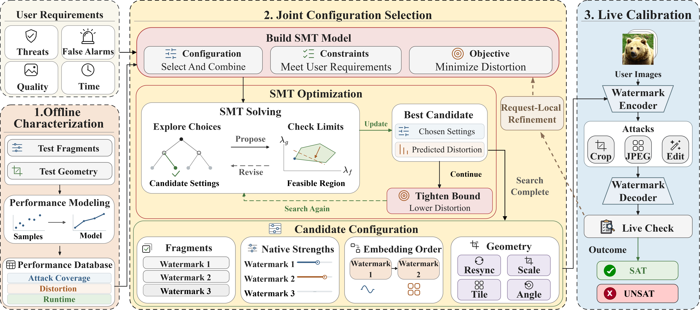

# Made to Measure: Designing Image Watermarks to Specification

You say what a watermark has to do. TAILOR gives you a configuration that does
it, or tells you no configuration can.



A request is four numbers and a list of attacks:

```bash
python solver/watermark_smt_v2.py --attacks jpeg25 crop75 regen --fpr 1e-6 --min_psnr 38 --max_ms 500
```

```
QUERY custom: PSNR>=38.0 ms<=500.0 FPR<=1e-06 (ba>=0.74) bits>=0 ['jpeg25', 'crop75', 'regen']
  VINE(alpha=0.7) + TrustMark   PSNR~38.3dB . 70ms
```

The answer names the fragments, the strength of each, the order to embed them
in, the geometric stage if one is needed, and the PSNR and latency to expect.

## Install

Solving requests needs three packages. The measured database is in `inputs/`,
so there is nothing to download and no GPU.

```bash
pip install z3-solver numpy scipy
python solver/watermark_smt_v2.py --attacks jpeg25 --fpr 1e-2 --min_psnr 42 --max_ms 100
```

To embed, attack and verify real images you also need PyTorch and the models:

```bash
pip install -r requirements.txt
export PYTHONPATH=$PWD:$PWD/solver:$PWD/measurement:$PWD/pipeline
python tools/fetch_models.py
```

## Models

Fetch the models:

```bash
python tools/fetch_models.py            # the fragments and the regeneration attack, 9.3 GB
python tools/fetch_models.py --check    # list what is installed, download nothing
python tools/fetch_models.py --only sd  # Stable Diffusion, for the regeneration attack
```

VINE is 9 GB of that. `--only trustmark videoseal regen` skips it, at 240 MB.

Source trees land in `external/`; weights go to the usual Hugging Face and PyTorch
caches. Downloaded for you:

| Component | Used for |
| --- | --- |
| TrustMark | a fragment |
| VINE | a fragment |
| VideoSeal | a fragment |
| WatermarkAttacker | the `regen`, `rinse2x`, `vaeB` and `vaeC` attacks |
| CtrlRegen | the `ctrlregen_s03`, `ctrlregen_s05` and `ctrlregen_s07` attacks (`--only ctrlregen`) |
| UnMarker | the `unmarker` attack (`--only unmarker`) |
| Stable Diffusion 2.1 | the `regen` and `rinse2x` attacks (`--only sd`) |

The Stable Diffusion repository is gated. Accept the terms on its model page and
run `hf auth login`, or set `TAILOR_SD21` to a local copy. The `vaeB` and `vaeC`
attacks need no model here: compressai fetches its own.

The image-editing attack (`editing_ip2p_s20_v1`, in `wbench/editing.py`) loads
InstructPix2Pix (`timbrooks/instruct-pix2pix`) through diffusers on first use.

Place these two yourself. `--check` prints the path each one goes to:

| Component | Used for | File |
| --- | --- | --- |
| SyncSeal | the geometric stage that rectifies before decoding | `syncmodel.jit.pt` |
| MaskWM | a baseline | `D_128bits.pth` |

CtrlRegen and UnMarker run out of process, through the drivers in
`scripts/attack/`. Install each in its own environment, following its own
instructions, and name that interpreter:

```bash
python tools/fetch_models.py --only ctrlregen unmarker
export TAILOR_CTRLREGEN_PYTHON=/path/to/ctrlregen-env/bin/python
export TAILOR_UNMARKER_PYTHON=/path/to/unmarker-env/bin/python
```

Either driver also runs on its own, on a directory of images:

```bash
$TAILOR_CTRLREGEN_PYTHON scripts/attack/ctrlregen_batch.py \
    --in_dir IMAGES --out_dir ATTACKED --step 0.7 --steps 50 --seed 1
$TAILOR_UNMARKER_PYTHON scripts/attack/unmarker_batch.py \
    --in_dir IMAGES --out_dir ATTACKED --config attack_configs/Vine.yaml
```

To put anything somewhere else, set the matching variable. `src/paths.py` has
them all in one place.

| Variable | Default |
| --- | --- |
| `TAILOR_MODELS` | `external/` |
| `TAILOR_WORKSPACE` | `workspace/`, where campaigns write |
| `TAILOR_POOL` | `$TAILOR_WORKSPACE/pool` |
| `TAILOR_VINE_REPO`, `TAILOR_VIDEOSEAL_REPO`, `TAILOR_WMATTACKER_REPO` | under `$TAILOR_MODELS` |
| `TAILOR_SYNCSEAL_JIT`, `TAILOR_MASKWM_CKPT` | under `$TAILOR_MODELS` |
| `TAILOR_CTRLREGEN_REPO`, `TAILOR_CTRLREGEN_CKPT`, `TAILOR_UNMARKER_REPO` | under `$TAILOR_MODELS` |
| `TAILOR_SD21` | `stabilityai/stable-diffusion-2-1` |
| `TAILOR_CTRLREGEN_PYTHON`, `TAILOR_UNMARKER_PYTHON` | unset |

## Solving requests

| Flag | Meaning |
| --- | --- |
| `--attacks` | the attacks the watermark must survive |
| `--fpr` | the false-positive budget one verification of one image may spend |
| `--min_psnr` | the fidelity floor, in dB |
| `--max_ms` | the latency ceiling, in ms, embedding plus verification |

The attacks this command measures, at a fixed fragment strength:

```
jpeg25  jpeg50  blur  noise  bright  contrast
crop90  crop75  crop50  rot9  rot30
vaeB  vaeC  regen  rinse
ctrlregen  ctrlregen_s03  ctrlregen_s05  ctrlregen_s07  unmarker
```

Any other name is reported as unmeasured. The continuous-strength mode the
campaigns run has its own columns, listed in the `attacks` key of
`inputs/surrogate_canonical.json`: `rinse2x`, `border20`, `crop_jpeg`, `hflip`
and `rs256` in place of `rinse`, `crop90`, `rot30`, `jpeg50` and `ctrlregen`.

`--fpr` sets the bit accuracy a verification has to reach, which the query line
prints next to it: `1e-2` asks for 0.63, `1e-6` for 0.74, `1e-9` for 0.80.
Tightening it alone can change the answer:

```bash
python solver/watermark_smt_v2.py --attacks jpeg25 regen --fpr 1e-1 --min_psnr 40 --max_ms 300
#   TrustMark   PSNR~41.3dB . 12ms
python solver/watermark_smt_v2.py --attacks jpeg25 regen --fpr 1e-2 --min_psnr 40 --max_ms 300
#   UNSAT
```

`UNSAT` means no configuration satisfies all four inputs at once:

```bash
python solver/watermark_smt_v2.py --attacks jpeg25 crop75 crop50 rot9 regen rinse --fpr 1e-6 --min_psnr 46 --max_ms 200
#   UNSAT - no combination satisfies these conditions
```

Use `--min_ba` instead of `--fpr` to state the bit accuracy directly. Give one
or the other, not both.

## Validating on your own images

Live calibration runs the whole embed, attack and decode path on your own
images and keeps only what passes there:

```bash
python solver/live_topk_full.py enumerate <class> <n_requests>   # candidates per request
python solver/live_topk_full.py measure   <class> [N=100]        # GPU: embed, attack, decode
python solver/live_topk_full.py walk      <class> [N=100]        # verdicts, no GPU
python solver/live_topk_full.py patch     <class> <shard> <n>    # re-solve what failed
```

`measure` writes one record per configuration and attack under
`$TAILOR_WORKSPACE/live_topk/cells/` and reuses what is already there, so a run
resumes and a configuration measured once serves every later request that picks
it.

## Releasing images

Calibration and every evaluation embed under the identities `img_<n>` and under
the evaluation key in `solver/eval_matrix.py`, which is public with this code.
Both are reserved for that purpose. Released images go through
`solver/deployment.py`, which takes a secret key and identities of the form
`dep:<name>` and refuses `img_<n>`. The false-positive bound holds for a
configuration that live calibration selected adaptively only under identities
that calibration never used, and this keeps the two apart.

```bash
python solver/deployment.py keygen > tailor.key        # 32 random bytes, in hex
export TAILOR_MASTER_KEY_FILE=tailor.key
python solver/deployment.py embed  --config cfg.json --identity dep:alice in.png out.png
python solver/deployment.py verify --config cfg.json --identity dep:alice --alpha 1e-6 out.png
```

`cfg.json` is the configuration the solver returned, and `--alpha` is the
request's false-positive budget. `python solver/test_deployment.py` checks the
identity and key rules and that evaluation embedding is unchanged, without
loading a model.

## Measuring your own fragments

To characterize a different fragment library, rebuild the database:

```bash
python pipeline/build_wm_dataset.py --out $TAILOR_WORKSPACE/pool   # the image pool
python pipeline/perimage_campaign.py                               # recovery, per image
python pipeline/make_delta_curves.py                               # interference, per ordered pair
python pipeline/make_frontend_components.py                        # the geometric stages
python pipeline/fit_surrogate_curves.py                            # knots to curves
python pipeline/make_canonical_surrogate.py                        # -> inputs/surrogate_canonical.json
```

## The paper's experiments

`experiments/` holds code of the paper's experiments on the 7,321-request
benchmark, as it ran: the measurement campaign behind the main comparison, the
ablations, the follow-up runs and the appendix analyses. No result is included.
`experiments/README.md` says which folder produced what and which environment
variables replace the locations of the machine they ran on.

## Repository layout

```
scripts/       the drivers for the two attacks that need their own environment
solver/        the SMT model, the request protocol, the live-calibration loop, deployment
measurement/   the verification rule, the FPR accounting, the measurement harness
src/           the fragments, the geometric stages, the attacks, soft decoding
pipeline/      the campaigns that build the database
inputs/        the measured database the solver reads
tools/         fetching the models
wbench/        the image-editing attack and the baseline watermark wrappers
experiments/   the code of the paper's experiments, without results
```

`inputs/surrogate_canonical.json` is the database: 60 recovery curves over
fragment strength, 120 interference curves per ordered pair and attack, 827
curves for the geometric stages, 181 per-image score sets behind those means,
and the distortion, latency and capacity entries. `inputs/requests.json` holds
the 7,321 requests the paper evaluates.

## License

MIT, see `LICENSE`. The fragments and the attack models are under their own
projects' licenses.

## Citation

```bibtex
@misc{tailor2026,
  title  = {Made to Measure: Designing Image Watermarks to Specification},
  author = {Anonymous},
  year   = {2026}
}
```
